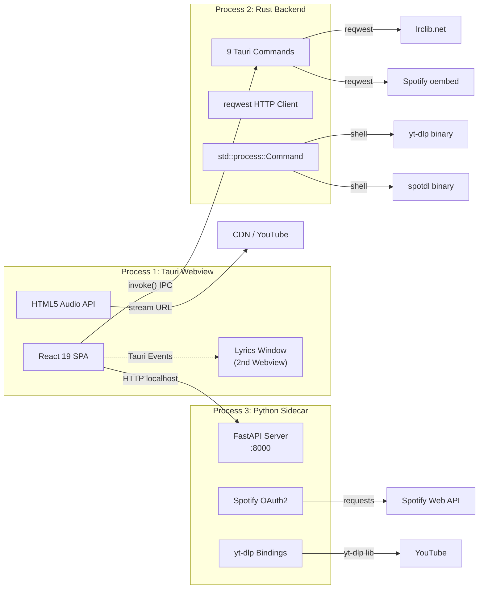
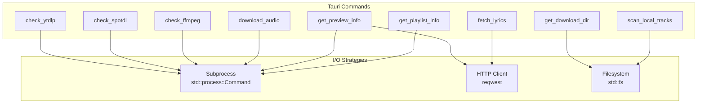
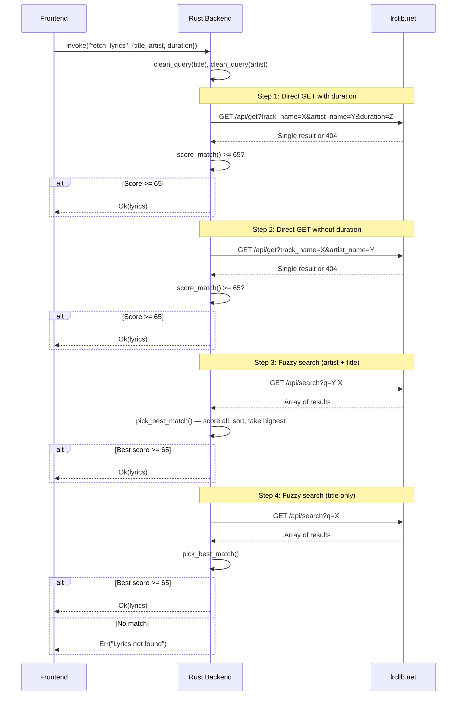
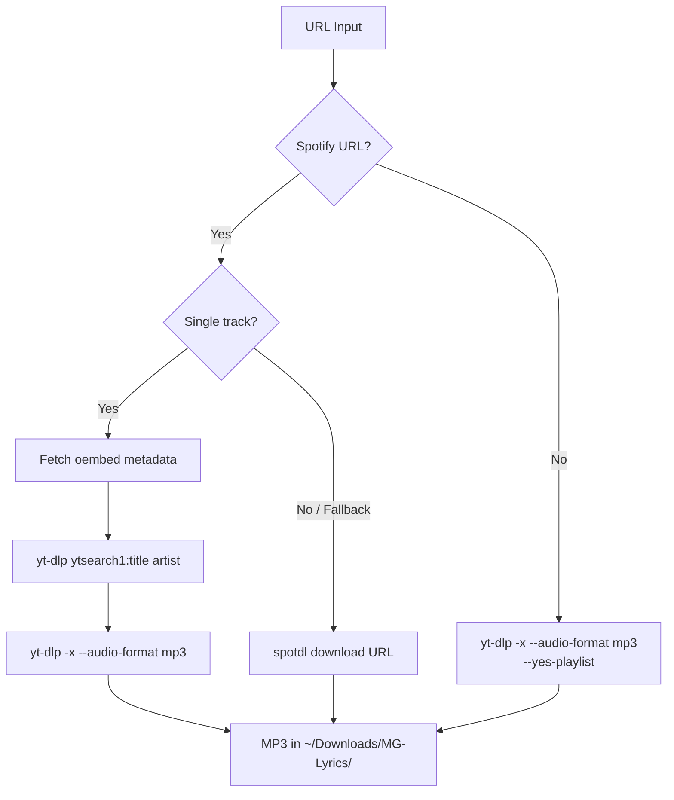
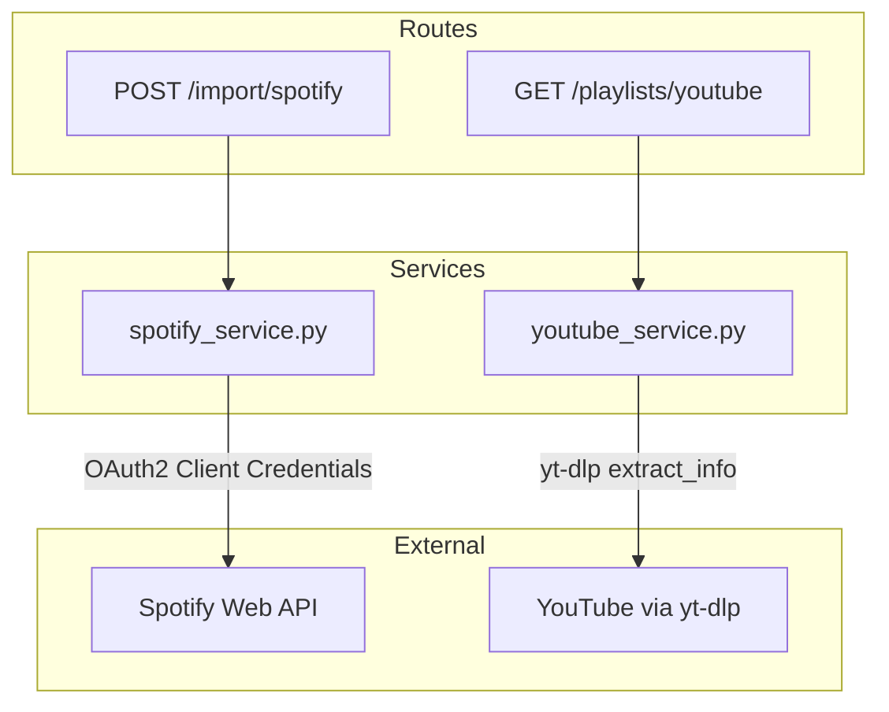
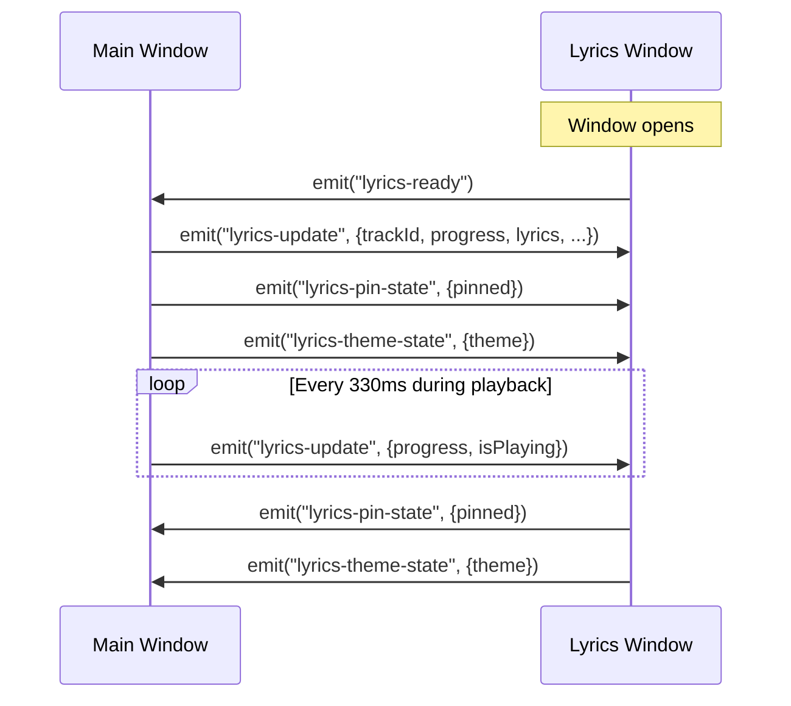
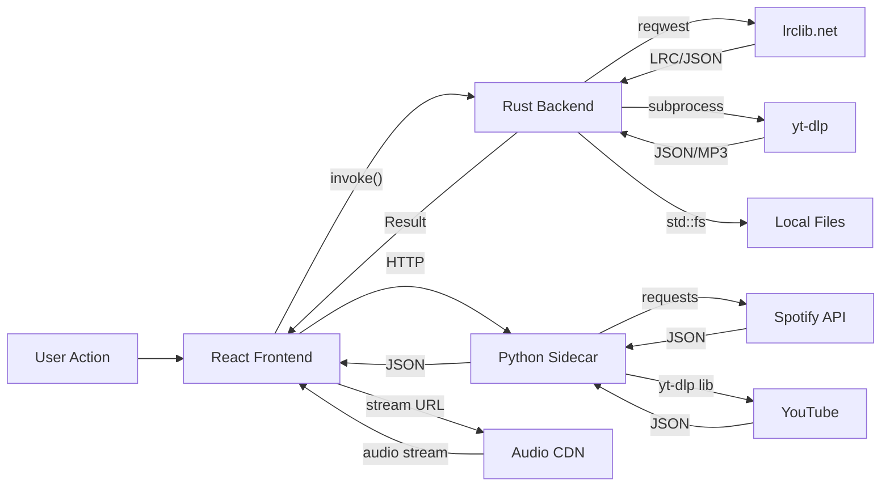

# Architecture

> Deep technical architecture of MG Lyrics Player — a three-layer desktop application built with Tauri v2, React 19, and Python FastAPI.

---

## System Overview

MG Lyrics Player is a **three-process desktop application**:

1. **Frontend** — React 19 SPA rendered in a Tauri webview, responsible for all UI and audio playback via the HTML5 Audio API.
2. **Tauri Backend** — Rust process providing native OS access, IPC bridge, lyrics fetching, audio download orchestration, and file system operations.
3. **Python Sidecar** — FastAPI server handling Spotify and YouTube playlist metadata extraction.

The frontend never makes direct network requests to external services (except audio streaming). All API calls route through either the Rust backend (lyrics, preview metadata) or the Python sidecar (playlist import).

---

## Layer Architecture



---

## Frontend Architecture

### Window Routing

The application uses **hash-based routing** at the entry point (`main.tsx`) to determine which root component renders:

```
window.location.hash === "#lyrics"
  → LyricsWindow (floating overlay)
  → App (main player)
```

This allows Tauri to spawn a second webview (`index.html#lyrics`) that loads the same bundle but renders an entirely different component tree. Both windows share the same Tauri process and communicate via the event system.

### Component Hierarchy

```
App.tsx (519 lines)
├── <audio> element (hidden, ref-controlled)
├── Sidebar.tsx (221 lines)
│   ├── Navigation menu (Home / Discover / Search / Downloads)
│   └── Playlist list (scrollable, color-coded by source)
├── ContentArea.tsx (1,957 lines)
│   ├── Home view (vinyl hero card + track list)
│   ├── Search view (client-side filter)
│   ├── Downloads view (URL input + preview + status dashboard)
│   ├── Discover view (YouTube playlist loader)
│   └── Playlist view (filtered track list)
└── PlayerBar.tsx (299 lines)
    ├── Album art + track info
    ├── Playback controls (prev / play-pause / next)
    ├── Progress bar (click-to-seek)
    ├── Volume slider + mute toggle
    └── Lyrics controls (theme / pin / toggle)
```

### State Management

The application uses **React hooks** (useState, useEffect, useCallback, useRef, useMemo) with no external state library. State is lifted to `App.tsx` and passed down via props.

| State Category | Location | Persistence |
|---------------|----------|-------------|
| Current track, queue, playback | `App.tsx` | None (in-memory) |
| Playlists | `App.tsx` | `localStorage("mg_playlists")` |
| Volume | `App.tsx` | `localStorage("mg_volume")` |
| Lyrics window position | `LyricsWindow.tsx` | `localStorage("mg_lyrics_pos")` |
| Font size | `LyricsWindow.tsx` | `localStorage("mg_lyrics_fontsize")` |
| URL history | `ContentArea.tsx` | `localStorage("mg_url_history")` |

**Why no state library:** The application has a single data owner (App.tsx) with unidirectional flow. Playlists, tracks, and playback state originate in App and flow downward. The only cross-window communication uses Tauri's native event system, not shared React state.

### Ref Strategy

Several values must be accessible inside event handlers and closures without triggering re-renders or creating stale references:

```typescript
audioRef        → HTML5 <audio> element
currentTrackRef → Current track (for throttled lyrics emit)
isPlayingRef    → Playing state (for audio error handler)
currentLyricsRef → Lyrics data (for lyrics window sync)
lyricsWinRef    → Window open state (for conditional emit)
lastEmitRef     → Last emit timestamp (throttle to 330ms)
retryCountRef   → Stream retry counter (max 1)
```

Each ref is synced via a corresponding `useEffect` that updates on state change. This pattern avoids recreating callbacks on every render while keeping closure-captured values current.

---

## Tauri Backend Architecture

### Command Surface

All backend logic lives in a single file (`src/lib.rs`, 917 lines). Nine commands are exposed to the frontend via `tauri::generate_handler![]`:



| Command | Async | I/O | External Dependency |
|---------|-------|-----|-------------------|
| `check_ytdlp` | No | Subprocess | yt-dlp binary |
| `check_spotdl` | No | Subprocess | spotdl binary |
| `check_ffmpeg` | No | Subprocess | ffmpeg binary |
| `get_download_dir` | No | Filesystem | None |
| `scan_local_tracks` | No | Filesystem | None |
| `download_audio` | Yes | Subprocess | yt-dlp or spotdl |
| `get_preview_info` | Yes | Subprocess + HTTP | yt-dlp, Spotify oembed |
| `fetch_lyrics` | Yes | HTTP | lrclib.net |
| `get_playlist_info` | Yes | Subprocess | yt-dlp |

### Lyrics Engine

The lyrics subsystem is the most algorithmically complex part of the backend. It implements a **4-step cascading search** with **Levenshtein-based confidence scoring**.



#### Confidence Scoring Formula

```
score = title_score + artist_score + duration_score

title_score   = levenshtein_similarity(query_title, result_title) × 50
artist_score  = levenshtein_similarity(query_artist, result_artist) × 40
duration_score:
  |diff| ≤ 5s   → 10.0
  |diff| ≤ 30s  → 10.0 × (1.0 - (diff - 5) / 25)
  |diff| > 30s  → 0.0
  unknown       → 5.0 (neutral)

threshold = 65.0
```

**Why Levenshtein over Jaccard:** The original implementation used word-overlap (Jaccard) which failed on short titles ("Dreams" matched "Broken Dreams"). Levenshtein measures edit distance, which is more sensitive to partial matches and reorderings.

**Why a 65 threshold:** Empirically chosen. At 50, false positives from live versions and remixes slip through. At 80, legitimate matches with slight metadata differences (featuring credits, remaster labels) are rejected.

### Query Cleaning

Before any API call, track names are normalized:

1. Remove bracketed content: `(Official Video)`, `[Lyrics]`, `{Remix}`
2. Remove featuring clauses: `feat.`, `ft.`, `ft `
3. Remove suffixes: `- Official`, `- Lyric`, `- Audio`, `- Video`, `- HD`, `- Live`
4. Collapse whitespace

This prevents YouTube-style titles like `"Artist - Song (Official Music Video) [4K]"` from failing exact-match lookups.

### Download Pipeline



**Why search YouTube for Spotify tracks:** Spotify doesn't provide direct audio streams without Premium + desktop SDK integration. By extracting the track name and artist from Spotify's oembed API and searching YouTube, the app can stream or download the audio without any Spotify authentication.

---

## Python Sidecar Architecture

### API Surface

```
FastAPI Server (port 8000)
├── GET  /health                → {"status": "ok"}
├── POST /import/spotify        → Playlist metadata + tracks
└── GET  /playlists/youtube     → Playlist metadata + videos
```

### Service Layer



### Spotify Authentication

The sidecar uses **Client Credentials** flow (app-level, not user-level):

1. Base64-encode `CLIENT_ID:CLIENT_SECRET`
2. POST to `https://accounts.spotify.com/api/token` with `grant_type=client_credentials`
3. Cache token until 60 seconds before expiry
4. Use token for Spotify Web API calls

**Why Client Credentials:** It doesn't require user login or redirect flow. The tradeoff is access to public data only — no private playlists, no Liked Songs, no user profile. This is intentional for v0.1.

### Pagination

Spotify playlists can contain thousands of tracks. The service implements cursor-based pagination:

```python
while url:
    resp = _api_get(url)
    tracks.extend(parse_items(resp["items"]))
    url = resp.get("next")  # None when exhausted
```

---

## Inter-Process Communication

### Frontend ↔ Rust Backend

All communication uses Tauri's `invoke()` IPC mechanism:

```typescript
// Frontend
const lyrics = await invoke<LyricLine[]>("fetch_lyrics", {
  title: "Blinding Lights",
  artist: "The Weeknd",
  durationSec: 200
});
```

```rust
// Backend
#[tauri::command]
async fn fetch_lyrics(title: String, artist: String, duration_sec: f64)
    -> Result<Vec<LyricLine>, String> { ... }
```

Arguments are serialized as JSON, deserialized by serde on the Rust side, and return values follow the same path in reverse.

### Main Window ↔ Lyrics Window

The two webview windows communicate via Tauri's **event system** (pub/sub over the same process):



**Why Tauri events over shared state:** The lyrics window runs in a separate webview with its own React tree. There's no shared JavaScript context. Tauri events are the IPC primitive designed for this — they're synchronous within the same process and don't involve network serialization.

**Throttling:** Lyrics updates are throttled to ~3/sec (330ms interval) via a ref-based timestamp check. This is fast enough for smooth word-by-word sync but avoids flooding the event bus during playback.

### Frontend ↔ Python Sidecar

The frontend communicates with the sidecar via standard HTTP:

```typescript
const resp = await fetch("http://localhost:8000/import/spotify", {
  method: "POST",
  body: JSON.stringify({ url: playlistUrl })
});
```

CORS is configured on the sidecar to allow `localhost:1420` (Tauri dev), `localhost:5173` (Vite), and `tauri.localhost` (production).

---

## Security Model

### Tauri Capabilities (ACL)

```json
{
  "identifier": "default",
  "windows": ["main", "lyrics"],
  "permissions": [
    "core:default",
    "opener:default",
    "core:window:allow-start-dragging",
    "core:window:allow-set-always-on-top",
    "core:window:allow-set-ignore-cursor-events",
    "core:webview:allow-create-webview-window",
    { "identifier": "http:default", "allow": [
      { "url": "https://lrclib.net/**" },
      { "url": "https://open.spotify.com/**" },
      { "url": "https://*/*" }
    ]}
  ]
}
```

| Permission | Reason |
|-----------|--------|
| `allow-start-dragging` | Lyrics window drag handle |
| `allow-set-always-on-top` | Lyrics overlay stays visible |
| `allow-set-ignore-cursor-events` | Click-through when pinned |
| `allow-create-webview-window` | Spawn lyrics window |
| HTTP scoping | Restrict webview network access |

### Asset Protocol

```json
"assetProtocol": {
  "enable": true,
  "scope": ["$DOWNLOAD/**"]
}
```

This allows the webview to load local audio files via `convertFileSrc()` — but only from the Downloads directory. The filesystem is otherwise inaccessible from JavaScript.

### Subprocess Safety

All external tool invocations use `std::process::Command::new()` with explicit argument arrays — never shell string interpolation. This eliminates command injection vectors regardless of user input.

---

## Data Flow Summary



---

## Design Decisions

| Decision | Choice | Rationale |
|----------|--------|-----------|
| **Desktop framework** | Tauri v2 over Electron | ~10x smaller binary, native Rust performance, capability-based security |
| **State management** | React hooks over Redux/Zustand | Single data owner, no cross-component state sharing needed |
| **Lyrics API** | LRCLib over Genius/Musixmatch | Free, no API key, provides synced LRC timestamps |
| **Audio source** | YouTube via yt-dlp over Spotify SDK | No Premium required, works offline after download |
| **Sidecar language** | Python over Node/Rust | yt-dlp native Python bindings, Spotify SDK ecosystem |
| **Styling** | Tailwind + inline styles over CSS modules | Rapid iteration, co-located with JSX, no class name management |
| **Window routing** | URL hash over Tauri multi-window API | Same bundle serves both windows, simpler build |
| **Lyrics matching** | Levenshtein over Jaccard | Better accuracy on short titles and partial matches |
| **Persistence** | localStorage over SQLite | Zero setup, adequate for playlist/preference data |

---

## Dependency Graph

```
Frontend (React 19)
├── @tauri-apps/api (IPC, events, window management)
├── @tauri-apps/plugin-http (HTTP scoping)
├── tailwindcss (styling)
└── vite (build)

Rust Backend (Tauri v2)
├── tauri (core framework)
├── reqwest (HTTP client for API calls)
├── tokio (async runtime)
├── serde + serde_json (serialization)
├── urlencoding (query parameter encoding)
├── tauri-plugin-http (webview HTTP permissions)
└── tauri-plugin-opener (open URLs in browser)

Python Sidecar (FastAPI)
├── fastapi + uvicorn (API server)
├── requests (Spotify API client)
├── yt-dlp (YouTube extraction)
└── python-dotenv (credential loading)

External Tools (System PATH)
├── yt-dlp (YouTube download/stream)
├── spotdl (Spotify download, optional)
└── ffmpeg (audio codec, recommended)
```
