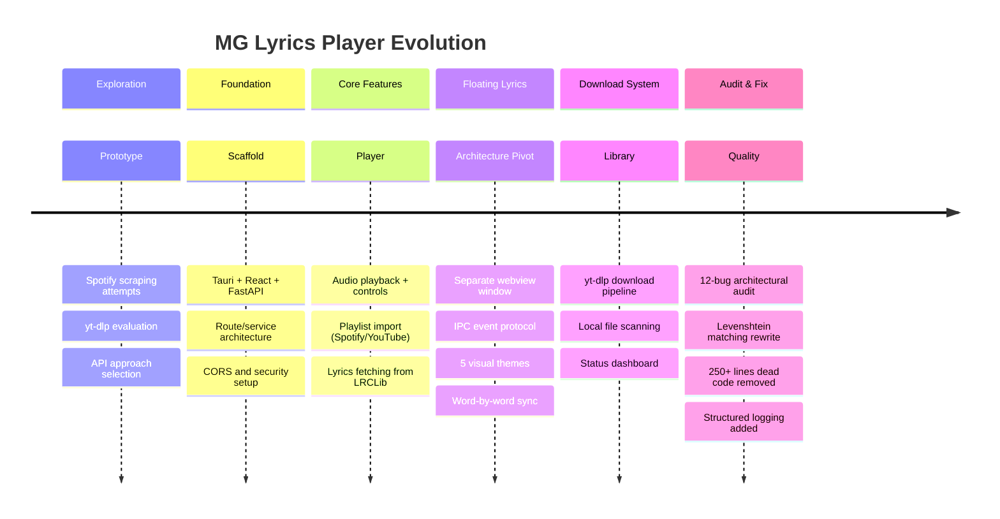

# Project Timeline

> Inferred evolution of MG Lyrics Player from code structure, configuration artifacts, audit reports, and implementation patterns.

---

## Phase 0: Exploration & Prototyping

**Evidence:** 7 scratch files in project root, `get_spotify_meta.py` in src-tauri

Before writing the application, several approaches to Spotify integration were explored:

| File | Approach Tested | Outcome |
|------|----------------|---------|
| `scratch_test_spotify_token.py` | Spotify web player token via browser endpoint | Abandoned — tokens are session-bound |
| `scratch_test_spotapi.py` | `spotapi` library for track extraction | Explored — functional but limited |
| `scratch_test_spotapi_playlist.py` | `spotapi` playlist pagination | Explored — pagination worked |
| `scratch_test_spotify_scrape.py` | HTML scraping `__NEXT_DATA__` from Spotify pages | Abandoned — fragile, breaks on layout changes |
| `scratch_test_spotipy_path.py` | Debug `spotipy` library path | Diagnostic utility |
| `scratch_search_playlist_html.py` | Regex extraction from saved playlist HTML | Abandoned — not scalable |
| `scratch_search_yt_playlists.py` | YouTube playlist search via HTML scraping | Explored — moved to yt-dlp instead |
| `get_spotify_meta.py` | Open Graph metadata scraping | Abandoned — replaced by oembed API |

**Key Decision:** After testing HTML scraping, browser tokens, and third-party libraries, the final architecture settled on the official Spotify Web API (Client Credentials flow) for metadata and yt-dlp for audio. This was the most reliable and maintainable combination.

---

## Phase 1: Foundation

**Evidence:** `.claude/plans/dreamy-doodling-flute.md`, initial `package.json`, `sidecar/` structure

### Architecture Established

The foundational architecture was defined in a planning document:

- **Python FastAPI sidecar** with two service modules:
  - `spotify_service.py` — Client Credentials OAuth2, playlist import with pagination
  - `youtube_service.py` — yt-dlp library bindings for playlist extraction
- **Tauri v2 + React scaffold** with Vite bundling
- **CORS configuration** for three origins: `localhost:1420`, `localhost:5173`, `tauri.localhost`
- **Three API endpoints**: Spotify playlist import, YouTube playlist extraction, health check

### First Components

- Basic React template rendered in Tauri webview
- Sidebar navigation skeleton
- FastAPI sidecar with route/service separation
- `.env` credential management for Spotify

### Technical Decisions Made

1. Python for the sidecar (yt-dlp native bindings, Spotify ecosystem)
2. Client Credentials over Authorization Code (no user login needed)
3. Tauri v2 over Electron (smaller binary, better security)
4. Vite over webpack (faster HMR, simpler config)

---

## Phase 2: Core Feature Implementation

**Evidence:** Component implementations, Tauri command surface, CSS design system

### Frontend Development

- **Sidebar.tsx** — Navigation with Home/Discover/Search/Downloads + playlist list
- **ContentArea.tsx** — Multi-view container with Home, Search, Downloads, and Discover views
- **PlayerBar.tsx** — Full playback control bar with progress, volume, and lyrics controls
- **HTML5 Audio integration** — Ref-controlled `<audio>` element with play/pause/seek

### Rust Backend Commands

Nine Tauri commands implemented:
1. `check_ytdlp`, `check_spotdl`, `check_ffmpeg` — System tool detection
2. `get_download_dir`, `scan_local_tracks` — File system operations
3. `download_audio` — yt-dlp/spotdl download orchestration
4. `get_preview_info` — YouTube/Spotify metadata resolution
5. `fetch_lyrics` — LRCLib.net lyrics fetching
6. `get_playlist_info` — Playlist metadata extraction

### Design System

- Glassmorphic dark theme with CSS custom properties
- 13-variable color system with neon purple accent
- Glass panels with `backdrop-filter: blur(24px)`
- Custom animations: EQ bars, spin, float, pulse
- Custom 5px scrollbar

### Lyrics Overlay (First Generation)

- `LyricsOverlay.tsx` — In-app modal with background blur
- Two modes: full-screen overlay and compact widget
- Limitation: Couldn't achieve true always-on-top behavior within the webview

---

## Phase 3: Floating Lyrics Window

**Evidence:** `LyricsWindow.tsx` (665 lines), multi-window IPC events, hash-based routing

### Architectural Pivot

The in-app `LyricsOverlay` was replaced with a separate Tauri webview window (`LyricsWindow.tsx`). This was a significant architectural change:

**Before:** Lyrics rendered as a React portal/modal within the main window
- Could not stay on top of other applications
- Could not be click-through
- Blocked the main window UI

**After:** Lyrics rendered in a separate transparent webview
- True always-on-top with `alwaysOnTop: true`
- Click-through via `setIgnoreCursorEvents(true)`
- Independent positioning, sizing, and theming
- IPC event synchronization at ~3 updates/sec

### New Components

- **Hash-based window routing** in `main.tsx`
- **5 visual themes** (Nebula, Cyberpunk, Terminal, Elegant, Minimal)
- **Word-by-word karaoke highlighting** using linear interpolation
- **Pin/drag mode toggle** for click-through vs. interactive states
- **Font size control** (Ctrl+Scroll, A-/A+ buttons, 14-60px range)
- **Position memory** via localStorage

### IPC Protocol

```
lyrics-update    (Main → Lyrics): trackId, progress, isPlaying, lyrics
lyrics-ready     (Lyrics → Main): request initial state on window open
lyrics-pin-state (bidirectional): pinned toggle synchronization
lyrics-theme-state (bidirectional): theme change synchronization
```

---

## Phase 4: Download & Library System

**Evidence:** Download panel in ContentArea, `download_audio` command, auto-scan logic

### Audio Download Pipeline

- URL input with preview capability
- Dual download strategy: yt-dlp for YouTube, spotdl/yt-dlp search for Spotify
- Output to `~/Downloads/MG-Lyrics/` with auto-created directory
- Post-download library refresh

### Local Library Management

- Folder scanning with audio extension filter
- `Artist - Title.mp3` filename convention parsing
- Auto-scan on startup
- Duplicate detection by audioUrl

### Status Dashboard

- Tool availability display (yt-dlp, spotdl, ffmpeg)
- Download directory path
- Local track count
- Scan folder button

---

## Phase 5: Architectural Audit & Remediation

**Evidence:** `AUDIT_REPORT.md`, `IMPLEMENTATION_PLAN.md`, `FINAL_IMPLEMENTATION_REPORT.md`

### Audit Process

A comprehensive architectural audit identified **12 bugs** across three severity levels:

| Severity | Count | Examples |
|----------|-------|---------|
| **P0 (Critical)** | 3 | Hardcoded lyrics database, ~150 lines dead code, reversed condition in matching |
| **P1 (High)** | 5 | Weak Jaccard similarity, 180s duration tolerance, no tool checks, stream expiration |
| **P2 (Medium)** | 4 | Silent error swallowing, Arabic character bypass, no structured logging |

### Remediation

All 12 bugs were systematically fixed:

| Category | Before | After |
|----------|--------|-------|
| Lyrics data sources | 3 duplicate paths | 1 source of truth (Rust backend) |
| Dead code | ~250 lines | 0 lines removed |
| Matching algorithm | Word-overlap (Jaccard) | Levenshtein confidence (0-100 scale) |
| Duration tolerance | ±180 seconds | ±5s full score, graduated to ±30s |
| Error handling | Silent `.catch(() => {})` | Structured logging + UI display |
| Tool detection | Hardcoded "Available" | Real subprocess checks |

### Key Algorithmic Change

The lyrics matching system was completely rewritten:

**Before (Jaccard):**
```
similarity = |intersection(words_a, words_b)| / |union(words_a, words_b)|
```
- Failed on short titles ("Dreams" ≈ "Broken Dreams" ≈ "Pipe Dreams")
- No weighting between title, artist, and duration

**After (Levenshtein):**
```
score = title_sim × 50 + artist_sim × 40 + duration_score × 10
```
- Edit distance is sensitive to partial matches
- Weighted scoring reflects field importance
- Duration scoring uses graduated decay (not binary)
- 65-point threshold empirically tuned

---

## Current Generation Architecture

```
┌─────────────────────────────────────────────────────────┐
│                     MG Lyrics Player                     │
│                                                          │
│  ┌──────────────────────────────────────────────────┐   │
│  │              Frontend (React 19 + TS)              │   │
│  │  App.tsx → Sidebar / ContentArea / PlayerBar       │   │
│  │  LyricsWindow.tsx → Floating overlay (2nd webview) │   │
│  │  Tailwind CSS 4 + Glassmorphic design system       │   │
│  └────────────────────┬─────────────────────────────┘   │
│                       │ invoke() IPC                     │
│  ┌────────────────────▼─────────────────────────────┐   │
│  │             Rust Backend (Tauri v2)                │   │
│  │  Lyrics: LRCLib API + Levenshtein matching        │   │
│  │  Audio: yt-dlp subprocess orchestration           │   │
│  │  Files: Directory scanning + path normalization   │   │
│  │  Tools: yt-dlp/spotdl/ffmpeg detection           │   │
│  └────────────────────┬─────────────────────────────┘   │
│                       │ subprocess / HTTP                 │
│  ┌────────────────────▼─────────────────────────────┐   │
│  │           Python Sidecar (FastAPI)                 │   │
│  │  Spotify: Client Credentials + playlist API       │   │
│  │  YouTube: yt-dlp library playlist extraction      │   │
│  └──────────────────────────────────────────────────┘   │
│                                                          │
│  External: lrclib.net · Spotify Web API · YouTube/yt-dlp │
└─────────────────────────────────────────────────────────┘
```

---

## Future Evolution Opportunities

### Near-Term (v0.2 - v0.5)

| Opportunity | Impact | Effort |
|------------|--------|--------|
| **Spotify OAuth2 Authorization Code** | Unlock private playlists, Liked Songs | Medium |
| **SQLite persistence** | Replace localStorage with queryable database | Medium |
| **Module decomposition** | Split lib.rs into focused modules | Low |
| **Automated test suite** | Unit tests for matching, parsing, scoring | Medium |
| **CI/CD pipeline** | GitHub Actions for build verification | Low |

### Medium-Term (v0.6 - v1.0)

| Opportunity | Impact | Effort |
|------------|--------|--------|
| **Genius lyrics fallback** | Second lyrics source for better coverage | Medium |
| **Media key support** | System-level play/pause/next shortcuts | Low |
| **Queue management** | Explicit queue with shuffle, repeat, reorder | Medium |
| **Sidecar lifecycle** | Auto-start, health check, graceful shutdown | Medium |
| **Auto-updater** | In-app update via Tauri's updater plugin | Medium |

### Long-Term (v1.0+)

| Opportunity | Impact | Effort |
|------------|--------|--------|
| **Music discovery engine** | Recommendation based on listening history | High |
| **Social features** | Share playlists, collaborative queues | High |
| **Mobile companion** | React Native app syncing with desktop | High |
| **Plugin system** | User-extensible lyrics/audio sources | High |
| **Offline-first PWA mode** | Service worker for offline library access | Medium |

---

## Evolution Summary


