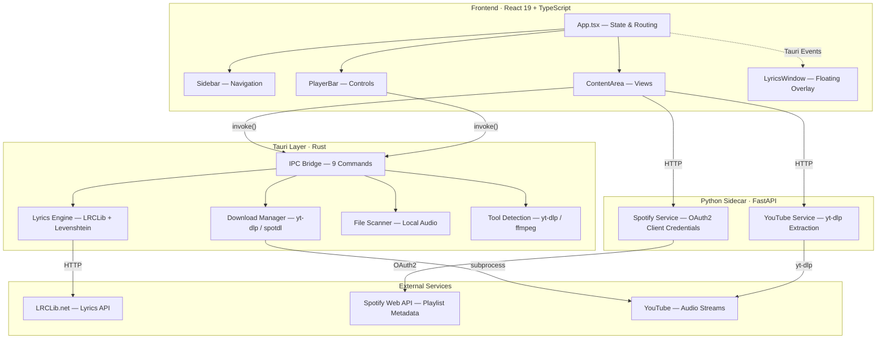
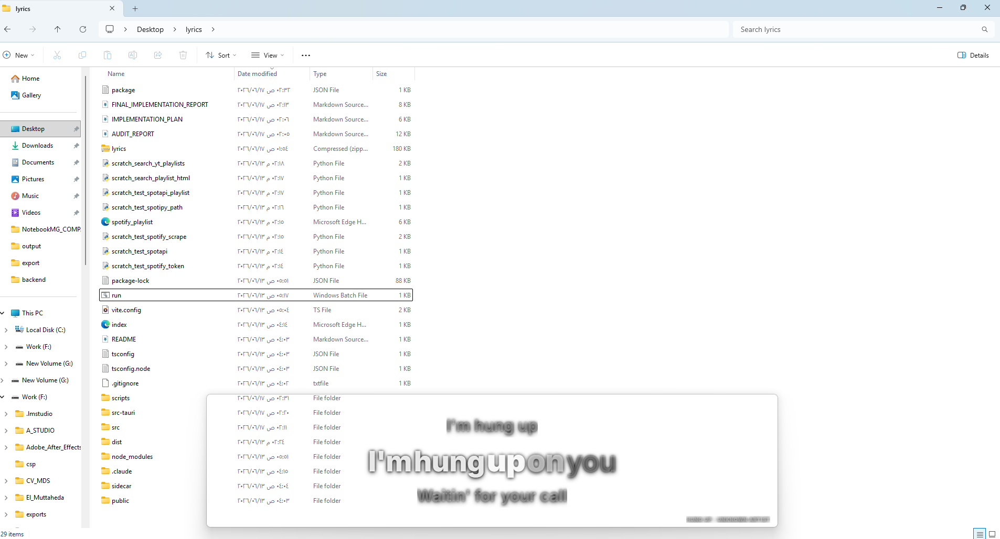
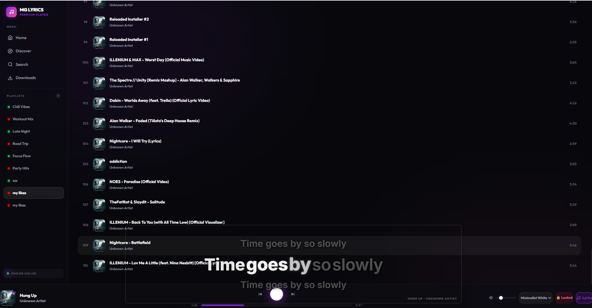
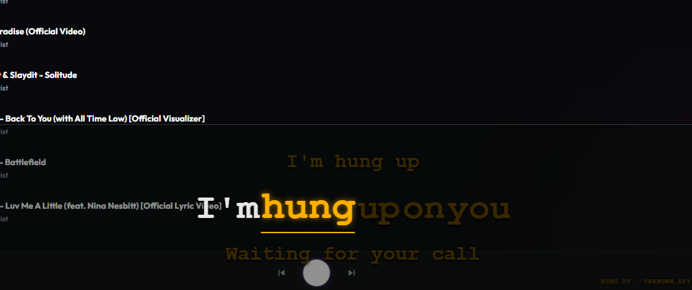
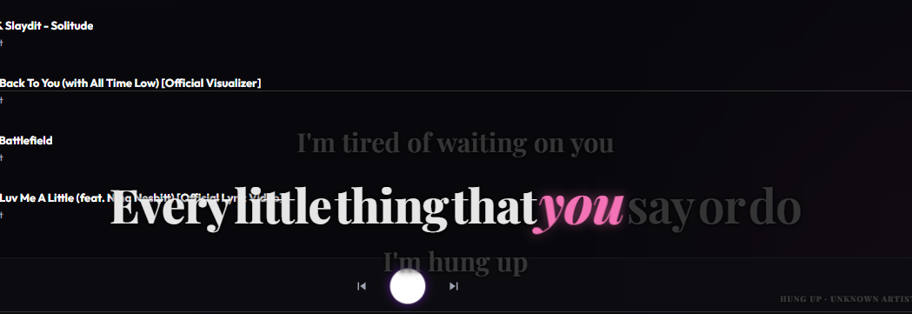

<p align="center">
  
</p>

<p align="center">
  <strong>A desktop music player with real-time synced lyrics, Spotify/YouTube import, and a floating karaoke overlay — built with Tauri, React, and Rust.</strong>
</p>

<p align="center">
  
  
  
  
  
  
</p>

---

## Overview

**MG Lyrics Player** is a cross-platform desktop music player that synchronizes lyrics to audio playback in real time. It imports playlists from Spotify and YouTube, streams or downloads audio via yt-dlp, fetches timestamped lyrics from LRCLib, and displays them in a floating, click-through overlay with word-by-word karaoke highlighting.

**Who it's for:** Music listeners who want synced lyrics while gaming, working, or browsing — without a browser tab or a premium subscription.

**Why it exists:** Spotify locks synced lyrics behind Premium. YouTube has no native lyrics overlay. MG Lyrics Player fills the gap with a free, local-first approach that works with any audio source.

---

## Key Features

### Playback & Audio
- Stream audio from YouTube via yt-dlp (no downloads required)
- Download tracks as MP3 from YouTube or Spotify URLs
- Play local audio files (MP3, FLAC, OGG, WAV, AAC, M4A, Opus)
- Auto-retry on expired stream URLs

### Lyrics
- Real-time synced lyrics from [LRCLib.net](https://lrclib.net) (free, no API key)
- Word-by-word karaoke highlighting with animated transitions
- 4-step search fallback with Levenshtein-based confidence scoring
- Plain lyrics auto-timed when synced timestamps unavailable
- Instrumental track detection

### Floating Overlay
- Transparent, borderless, always-on-top lyrics window
- Click-through mode (doesn't steal focus from games or apps)
- 5 visual themes: Nebula, Cyberpunk, Terminal, Elegant, Minimal
- Adjustable font size (14-60px) with Ctrl+Scroll
- Position memory across sessions

### Library & Playlists
- Import Spotify public playlists (no Premium or API key required)
- Import YouTube playlists via yt-dlp
- Auto-scan local download folder on startup
- Create custom playlists from any source
- Full-text search across title, artist, and album

### System Integration
- Automatic detection of yt-dlp, spotdl, and ffmpeg
- Status dashboard showing tool availability
- Cross-platform download directory management
- Tauri v2 capability-based security model

---

## Architecture Overview



---

## Tech Stack

| Layer | Technology | Purpose |
|-------|-----------|---------|
| **Frontend** | React 19, TypeScript 5.8, Tailwind CSS 4 | UI components, state management, styling |
| **Build** | Vite 7, @vitejs/plugin-react | HMR, bundling, dev server |
| **Desktop** | Tauri v2 (Rust 2021) | Native windowing, IPC, security, file access |
| **Backend** | Python 3.9+ FastAPI | Spotify/YouTube playlist import sidecar |
| **Audio** | HTML5 Audio API, yt-dlp | Streaming, download, format conversion |
| **Lyrics** | LRCLib.net API, LRC parser | Timestamped lyrics with confidence matching |
| **HTTP** | reqwest (Rust), requests (Python) | API calls from both backend layers |

---

## Screenshots

<p align="center">
  
  <br/><em>Main player with playlist and track list</em>
</p>

<p align="center">
  
  <br/><em>Download panel with system status dashboard</em>
</p>

<p align="center">
  
  <br/><em>Floating lyrics overlay with karaoke-style highlighting</em>
</p>

<p align="center">
  
  <br/><em>YouTube playlist discovery and import</em>
</p>

---

## How It Works

1. **Import a playlist** — Paste a Spotify or YouTube playlist URL. The app fetches metadata (titles, artists, durations, artwork) without downloading any audio.

2. **Select a track** — The app searches YouTube for the best audio match using yt-dlp, resolves a direct stream URL, and begins playback through the HTML5 Audio API.

3. **Lyrics are fetched automatically** — The Rust backend queries LRCLib.net using a 4-step fallback strategy (direct match with duration, direct match without duration, fuzzy search artist+title, fuzzy search title-only). Each candidate is scored with a Levenshtein-based confidence algorithm (title 50pts + artist 40pts + duration 10pts, threshold >= 65).

4. **Floating overlay syncs in real time** — A separate transparent Tauri window receives playback state via IPC events (~3 updates/sec). The overlay calculates word-by-word progress within each lyric line and applies theme-specific animations.

5. **Download for offline use** — Optionally download tracks as MP3 via yt-dlp. Downloaded files are automatically detected on next launch via folder scanning.

---

## Installation

### Prerequisites

| Tool | Required | Purpose |
|------|----------|---------|
| [Node.js](https://nodejs.org/) >= 18 | Yes | Frontend build tooling |
| [Rust](https://rustup.rs/) >= 1.70 | Yes | Tauri backend compilation |
| [Python](https://python.org/) >= 3.9 | Yes | Sidecar backend |
| [yt-dlp](https://github.com/yt-dlp/yt-dlp) | Yes | YouTube audio streaming & download |
| [ffmpeg](https://ffmpeg.org/) | Recommended | Audio format conversion |
| [spotdl](https://github.com/spotDL/spotify-downloader) | Optional | Spotify track downloads |

### Setup

```bash
# Clone the repository
git clone https://github.com/yourusername/mg-lyrics-player.git
cd mg-lyrics-player

# Install frontend dependencies
npm install

# Install Python sidecar dependencies
cd sidecar
pip install -r requirements.txt
cd ..

# (Optional) Create .env for Spotify API credentials
cp sidecar/.env.example sidecar/.env
# Edit sidecar/.env with your Spotify Client ID and Secret
```

### Development

```bash
# Start the Tauri development app (launches frontend + backend)
npm run tauri dev

# Or start components individually:
# Terminal 1: Frontend dev server
npm run dev

# Terminal 2: Python sidecar
cd sidecar && uvicorn main:app --reload

# Terminal 3: Tauri app
npm run tauri dev
```

### Production Build

```bash
npm run tauri build
# Output: src-tauri/target/release/bundle/
#   Windows: .exe, .msi
#   macOS:   .app, .dmg
#   Linux:   AppImage, .deb
```

---

## Project Structure

```
mg-lyrics-player/
├── src/                          # React frontend
│   ├── main.tsx                  # Entry point (hash-based window routing)
│   ├── App.tsx                   # Main player shell & state management
│   ├── components/
│   │   ├── Sidebar.tsx           # Navigation & playlist list
│   │   ├── ContentArea.tsx       # Dynamic views (Home/Search/Downloads/Discover)
│   │   ├── PlayerBar.tsx         # Playback controls & progress bar
│   │   ├── LyricsWindow.tsx      # Floating overlay (separate Tauri window)
│   │   ├── LyricsOverlay.tsx     # [Legacy] In-app lyrics modal
│   │   └── TrackList.tsx         # [Legacy] Reusable track list
│   ├── utils/
│   │   └── lyrics.ts             # LRC parser & plain lyrics timing
│   └── index.css                 # Design system & animations
│
├── src-tauri/                    # Rust backend
│   ├── src/
│   │   ├── lib.rs                # All Tauri commands (917 lines)
│   │   └── main.rs               # Entry point
│   ├── capabilities/
│   │   └── default.json          # ACL permissions
│   ├── Cargo.toml                # Rust dependencies
│   └── tauri.conf.json           # Tauri configuration
│
├── sidecar/                      # Python backend
│   ├── main.py                   # FastAPI app & CORS setup
│   ├── routes/
│   │   ├── spotify.py            # POST /import/spotify
│   │   └── youtube.py            # GET /playlists/youtube
│   ├── services/
│   │   ├── spotify_service.py    # Spotify OAuth2 + playlist API
│   │   └── youtube_service.py    # yt-dlp playlist extraction
│   └── requirements.txt          # Python dependencies
│
├── scripts/
│   └── kill-port.cjs             # Dev utility: kill stale port
├── images/                       # UI screenshots
├── package.json                  # Node.js configuration
├── vite.config.ts                # Vite + Tailwind config
├── tsconfig.json                 # TypeScript configuration
└── run.bat                       # Windows dev startup script
```

---

## Current Status

> **Beta** — Core features are functional and have been through a full architectural audit with 12 identified bugs fixed. The application builds cleanly (TypeScript + Rust zero errors) and runs on Windows. macOS and Linux builds are supported by Tauri but not yet tested.

---

## Known Limitations

- **No Spotify streaming** — Audio is sourced from YouTube, not Spotify directly. Spotify URLs are resolved to YouTube searches.
- **No user authentication** — Spotify import uses Client Credentials (public playlists only). Private playlists and Liked Songs require OAuth2 Authorization Code flow (planned).
- **No persistent database** — Library state lives in localStorage. Closing the app preserves playlists but not play history or queue position.
- **Stream URL expiration** — YouTube stream URLs expire after ~6 hours. The app retries once, but extended sessions may require manual track re-selection.
- **External tool dependency** — yt-dlp must be installed separately. The app detects but cannot auto-install it.

---

## Roadmap

- [ ] Spotify OAuth2 Authorization Code flow (Liked Songs, private playlists)
- [ ] YouTube OAuth integration (Liked Videos, subscriptions)
- [ ] SQLite persistent library with play history and queue state
- [ ] Media key support (play/pause/next via keyboard shortcuts)
- [ ] Genius lyrics fallback for tracks not on LRCLib
- [ ] Auto-updater and yt-dlp bundling for production release

---

## Contributing

Contributions are welcome. Please:

1. Fork the repository
2. Create a feature branch (`git checkout -b feature/your-feature`)
3. Commit your changes (`git commit -m 'Add your feature'`)
4. Push to the branch (`git push origin feature/your-feature`)
5. Open a Pull Request

For bugs, please open an issue with reproduction steps and your OS/tool versions.

---

## License

MIT License — see [LICENSE](LICENSE) for details.

---

<p align="center">
  Built with <a href="https://v2.tauri.app">Tauri</a> · <a href="https://react.dev">React</a> · <a href="https://www.rust-lang.org">Rust</a> · <a href="https://fastapi.tiangolo.com">FastAPI</a>
</p>
